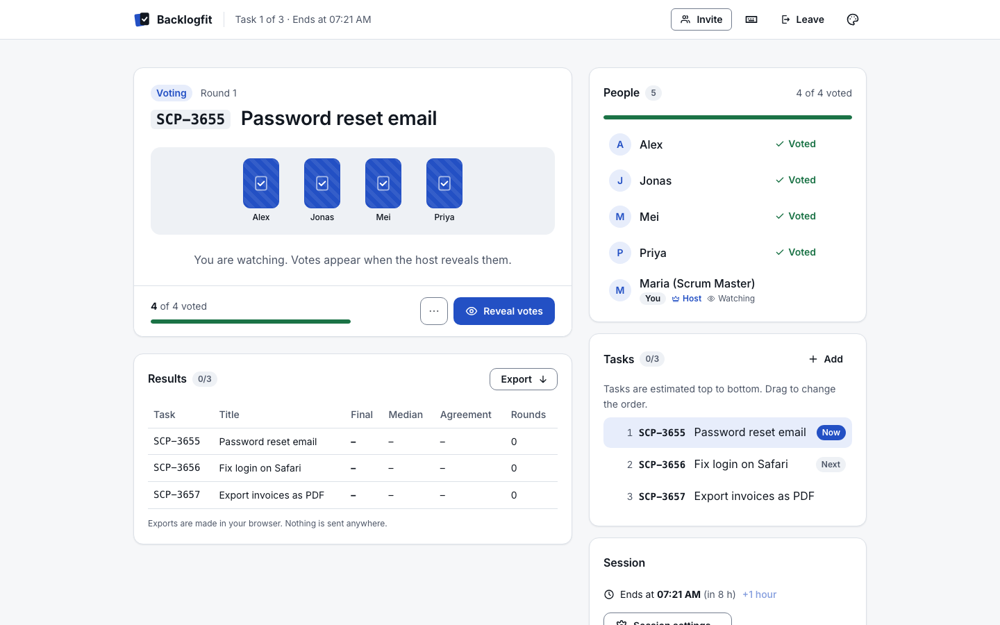
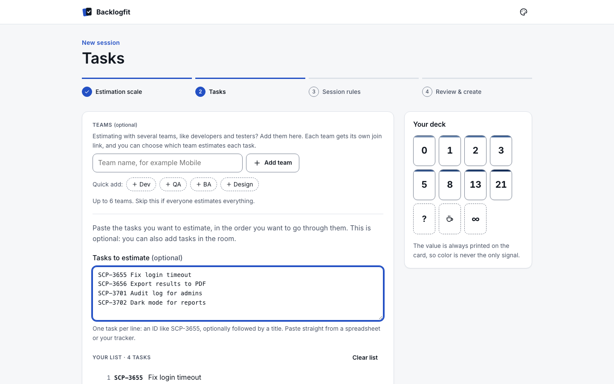
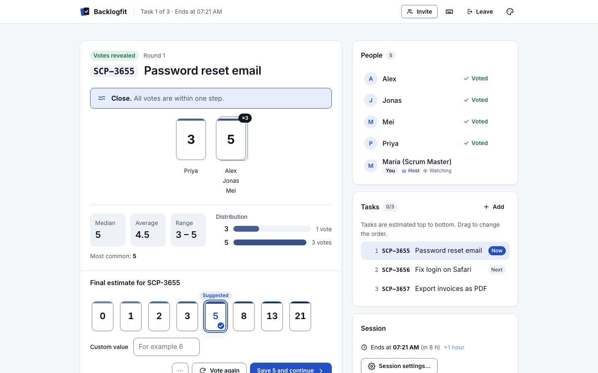

# Backlogfit

**Fit the backlog. Estimate together.**

[](https://github.com/Sinet2000/backlogfit/actions/workflows/ci.yml)
[](LICENSE)
[](https://securityscorecards.dev/viewer/?uri=github.com/Sinet2000/backlogfit)

Backlogfit is an open-source story point estimation tool for agile teams, a calm and private
alternative to planning poker apps. The host prepares a list of backlog items, shares one link,
and the team votes with cards, reveals together and agrees on an estimate.

It is built for organisations with strict security policies, such as banks, insurers and
public bodies:

- **No sign-up.** No accounts, emails, cookies, analytics or third-party requests.
- **Votes stay secret.** Nobody, the host included, receives another person's vote before the reveal.
- **Nothing is kept.** A session ends after 2 hours by default (8 hours at most) and all its data is deleted.
- **Runs where you want.** One small, signed container you can host inside your own network.



## Contents

- [How it works](#how-it-works)
- [Features](#features)
- [Run it locally](#run-it-locally)
- [Self-hosting](#self-hosting)
- [Configuration](#configuration)
- [Security and privacy](#security-and-privacy)
- [Architecture](#architecture)
- [Development](#development)
- [Contributing](#contributing)
- [License, credits and author](#license)

## How it works

1. **Set up a session** in four short steps: pick a card deck, paste the tasks in the order you
   want to discuss them, choose the session rules, and create it.
2. **Share the join link** or QR code. People type a display name and they are in.
3. **Vote in secret.** Everyone sees who has voted, never what.
4. **Reveal together.** Cards are grouped by value with the median, average, range,
   distribution and a plain-language agreement indicator.
5. **Save and continue.** The host confirms the final estimate (the suggested value is
   preselected) and moves to the next task in one click. Export the results at the end.

| Prepare the tasks | Reveal |
|---|---|
|  |  |

More screenshots are in [docs/assets/screenshots](docs/assets/screenshots/). The
[Manager Guide](docs/MANAGER-GUIDE.md) explains how to run a refinement session in 10 steps.

## Features

- **Card decks:** Fibonacci, modified Fibonacci, T-shirt sizes, powers of two, linear 1–10 or a
  custom deck, plus the special cards *Not sure*, *Break* and *Too big*. Every card shows its
  value, so colour is never the only signal.
- **Task list:** paste task IDs (for example `SCP-3655 Fix login`), links or titles. The list
  keeps your order; drag to reorder, estimate any task right away, or add one in the middle of the
  discussion. Optional link template for your tracker and a link policy (IDs only, any link, or
  only your own domains).
- **Voting:** auto-reveal when everyone has voted, re-vote with history per task, round timer,
  anonymous results, keyboard shortcuts (1–9, Space to reveal, N for next, ? for help).
- **People:** co-hosts, spectators, waiting room with approval, optional passcode, lock, remove a
  participant, maximum number of people.
- **Teams:** up to six teams with their own join links, tasks only one team estimates (`#qa`),
  and a per-team median on shared tasks.
- **Results:** CSV, JSON, Markdown, a copyable summary for your ticket, and a print layout. All
  generated in the browser.
- **Presets:** save the session settings as a JSON file and load them next time. Nothing is stored
  on a server.
- **Accessible:** WCAG 2.2 AA, full keyboard use, screen reader labels, light, dark and
  high-contrast modes, reduced motion, phone-friendly layout. Two looks: *Corporate* (default)
  and *Colorful*.

## Run it locally

Requirements: Node 24 and pnpm 11.

```sh
pnpm install
pnpm start
```

Open <http://localhost:8080>. `pnpm start` builds the web app and serves it, together with the
API, from the Node server in production mode. Stop it with Ctrl-C.

## Self-hosting

Each release publishes a container image to `ghcr.io/sinet2000/backlogfit`. It is signed with
cosign and comes with an SBOM and build provenance. The image is distroless, runs as a
non-root user, works with a read-only filesystem and keeps sessions in memory by default.

```sh
podman run -d --name backlogfit \
  -p 127.0.0.1:8080:8080 \
  --read-only --tmpfs /tmp:rw,size=16m,mode=1777,noexec,nosuid,nodev \
  --cap-drop=ALL --security-opt=no-new-privileges \
  --memory=256m --pids-limit=128 \
  -e PUBLIC_ORIGIN=https://estimate.example.com \
  -e TRUST_PROXY=true \
  ghcr.io/sinet2000/backlogfit:latest
```

`docker run` takes the same flags. Put the container behind a reverse proxy that terminates TLS;
that is why the port is bound to localhost and `TRUST_PROXY` is set. To keep sessions across
restarts, add `-e DATA_DIR=/data -v backlogfit-data:/data`.

Build the image yourself:

```sh
podman build --format docker -f apps/server/Containerfile -t backlogfit .
```

`--format docker` keeps the image's `HEALTHCHECK` under Podman. A Compose example is in
[apps/server/compose.example.yml](apps/server/compose.example.yml). Reverse proxy snippets,
hardening advice and how to verify the signature are in
[docs/security/SELF_HOSTING.md](docs/security/SELF_HOSTING.md).

A Cloudflare Workers build is included as well, in [apps/worker](apps/worker/) (one Durable
Object per session; `wrangler deploy --env production`).

## Configuration

Everything is set with environment variables, and every variable has a safe default. The most
common ones:

| Variable | Default | Purpose |
|---|---|---|
| `PUBLIC_ORIGIN` | `http://localhost:8080` | The exact public address. Required in production. |
| `TRUST_PROXY` | `false` | `true` or a hop count when behind a reverse proxy. |
| `DATA_DIR` | empty (memory only) | Directory for the SQLite file if sessions should survive restarts. |
| `DEFAULT_LIFETIME_HOURS` | `2` | Default session length. |
| `MAX_LIFETIME_HOURS` | `8` | Hard limit, extensions included. |
| `IDLE_TIMEOUT_MINUTES` | `30` | A session without activity ends after this time. |
| `MAX_PARTICIPANTS` | `50` | Upper limit per session. |
| `ROOM_CREATE_PER_MIN` | `10` | Sessions created per client address per minute. |

The full list, with ranges and connection limits, is in
[docs/security/SELF_HOSTING.md](docs/security/SELF_HOSTING.md#3-environment-variables).

## Security and privacy

- **Secrets stay in your browser.** The join and host secrets are created in the browser and live
  only in the part of the link after `#`, which browsers never send to a server. The server keeps
  SHA-256 hashes and compares them in constant time.
- **Votes are secret until the reveal.** One projection function builds what each person may see,
  and property-based tests check that no vote value leaves the server early.
- **Strict browser policy.** Content Security Policy without inline scripts or styles, Trusted
  Types, HSTS, `Referrer-Policy: no-referrer`, a locked-down Permissions Policy, and isolation
  headers. Fonts and images are self-hosted.
- **Validated input.** Every message is size-limited and schema-validated, and every connection
  and session is rate-limited. Task text is always shown as text, and links are http(s) only.
- **No logs of people.** The app stores no IP addresses, user agents or names beyond the
  session, and it has no access logs.
- **Supply chain.** Pinned dependencies and actions, CodeQL, OSV-Scanner, gitleaks, Trivy,
  OpenSSF Scorecard, CycloneDX SBOMs, signed images and build provenance.

Details: [privacy statement](docs/security/PRIVACY.md), [threat model](docs/security/THREAT_MODEL.md),
[security review](docs/security/SECURITY_REVIEW.md). Please report vulnerabilities privately as
described in [SECURITY.md](SECURITY.md).

## Architecture

```
apps/web          SvelteKit static site: content pages are prerendered, the session app runs in the browser
apps/server       Node 24 + Hono + ws + node:sqlite, packaged as a container
apps/worker       Cloudflare Worker with one Durable Object per session
packages/core     pure TypeScript: message schemas, session reducer, projection, statistics, task parsing
packages/host     the session pipeline shared by both backends: limits, queueing, timers, storage
packages/security security headers, rate limiting, client keys, origin checks, limits
tests/e2e         Playwright tests: multi-user sessions, accessibility, visual snapshots
tests/load        WebSocket load test
```

All session behaviour lives in one deterministic reducer, `reduce(state, event)` in
`packages/core`. `packages/host` runs it the same way for both backends, which only add sockets,
storage and timers. Clients receive a fresh, projected snapshot after every change. See the
[protocol](docs/protocol/PROTOCOL.md), the [architecture decisions](docs/adr/) and the
[dependency list](docs/DEPENDENCIES.md), where every dependency is justified.

## Development

```sh
pnpm dev          # API on :8080 and the web app with hot reload on http://localhost:5173
pnpm verify       # lint, typecheck and unit tests
pnpm build        # build every package and app
pnpm e2e          # end-to-end and accessibility tests in Chromium, Firefox and WebKit
pnpm test:visual  # visual snapshots in the Linux Playwright container (needs Podman)
pnpm test:all     # all of the above, in order
pnpm load         # WebSocket load test against a running server
pnpm format       # apply Biome formatting
```

Install the test browsers once with `pnpm --filter @backlogfit/e2e exec playwright install`.

## Contributing

Contributions are welcome. Read [CONTRIBUTING.md](CONTRIBUTING.md) first: commits need a DCO
sign-off (`git commit -s`), use Conventional Commit messages, and every change comes with tests.
Please follow the [Code of Conduct](CODE_OF_CONDUCT.md).

## License

Apache License 2.0. See [LICENSE](LICENSE) and [NOTICE](NOTICE).

## Credits

Inspired by the estimation technique described in Mike Cohn's book 'Agile Estimating and Planning' (planning poker, originally described by James Grenning). Backlogfit is an independent project, not affiliated with or endorsed by the authors or publishers.

## Author

Nikita Nikitins (NN Y2K0)

[LinkedIn](https://www.linkedin.com/in/nn-y2k0) · [GitHub](https://github.com/Sinet2000)

<!-- company-attribution:start -->
Dexlaris
<!-- company-attribution:end -->

See also [AUTHORS.md](AUTHORS.md).
