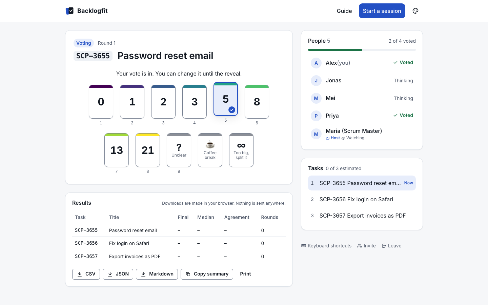
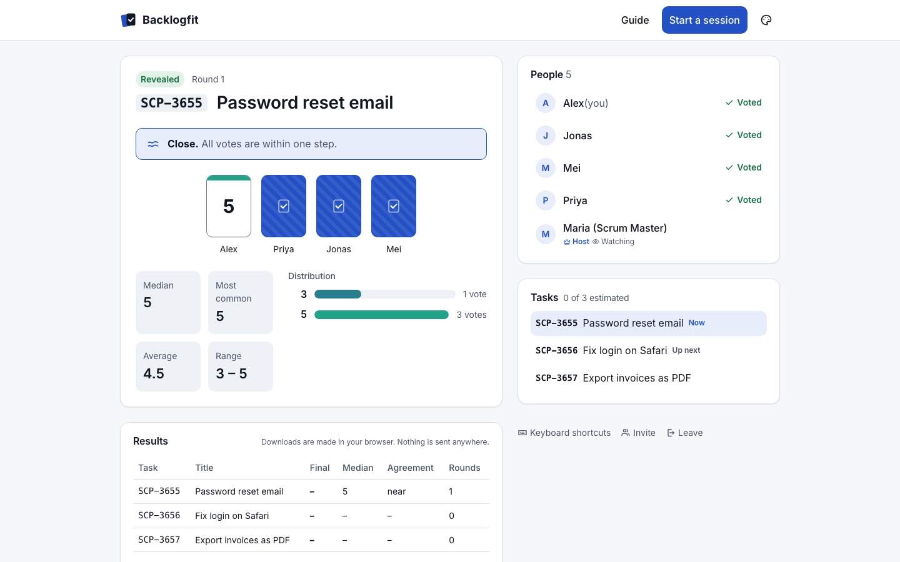
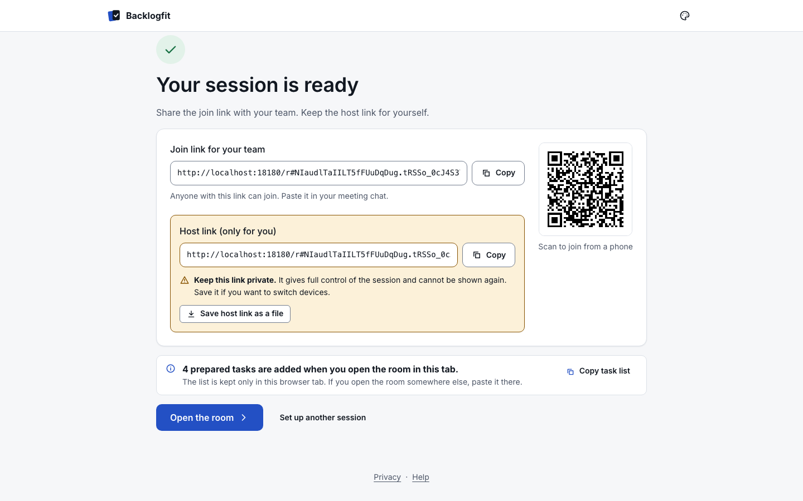

# Backlogfit

**Fit the backlog. Estimate together.**

[](https://github.com/Sinet2000/backlogfit/actions/workflows/ci.yml)
[](LICENSE)
[](https://securityscorecards.dev/viewer/?uri=github.com/Sinet2000/backlogfit)

Backlogfit is an open-source, privacy-first tool for story point estimation. A facilitator
creates a room, shares one link, and the team votes on backlog items with cards, reveals
together, and settles on a final estimate. There are no accounts, no sign-up, no tracking and
no third-party requests; rooms expire after a few hours and everything about them is deleted.
It is built to pass the security review of strict organizations such as banks: secrets never
leave the URL fragment, the server stores only hashes, and vote values are never sent to
anyone before the reveal. Use it at [backlogfit.com](https://backlogfit.com) or self-host it
with one container.

## Screenshots

| Voting | Reveal |
|---|---|
|  |  |

| Room created | Facilitator controls |
|---|---|
|  |  |

More screenshots (configurator steps, results, landing page) are in
[docs/assets/screenshots](docs/assets/screenshots/) and the [Manager Guide](docs/MANAGER-GUIDE.md).

## Features

- **Card decks**: Fibonacci, modified Fibonacci, powers of two, linear 1–10, T-shirt sizing, or
  your own custom scale, plus special cards (`?`, coffee, `∞`). Colorblind-safe palette.
- **Facilitation**: task list from pasted IDs or links, next/select task, reveal, re-vote with
  history, final estimate, countdown timer, auto-reveal when everyone has voted.
- **Team controls**: lobby with approve/deny, optional passcode, lock room, kick, co-facilitators,
  spectators, anonymous reveal.
- **Statistics**: distribution, median, mode, average, spread and a consensus indicator.
- **Exports**: CSV, JSON, Markdown and a plain-text summary, generated locally in the browser.
- **Link policy**: accept only task IDs, any links, or links to an allowlist of your own hosts.
- **Accessible**: keyboard shortcuts, screen-reader labels, light/dark/high-contrast modes,
  reduced motion, print stylesheet.
- **Two backends, one logic**: Cloudflare Workers + Durable Objects, or a small Node server in a
  container. Both run the same pure reducer.

## Quick start (development)

Requirements: Node 24 and pnpm 11.

```sh
pnpm install && pnpm dev
```

Open <http://localhost:5173>. `pnpm dev` runs the API server on port 8080 and the web app
with hot reload on 5173, which proxies `/api` and `/ws` to the server.

Useful scripts:

```sh
pnpm start        # production build served by the Node server on http://localhost:8080
pnpm verify       # lint + typecheck + unit tests
pnpm build        # build all packages and apps
pnpm e2e          # Playwright end-to-end and accessibility tests, server included
pnpm test:visual  # visual snapshots in the Linux Playwright container (Podman)
pnpm test:all     # everything above, in order
pnpm load         # WebSocket load test against a running server (see tests/load)
```

Install the Playwright browsers once with `pnpm --filter @backlogfit/e2e exec playwright install`.

## Self-host with Podman or Docker

The container image is published to `ghcr.io/sinet2000/backlogfit`, signed with cosign and
shipped with an SBOM and build provenance. It is distroless, runs as a non-root user with a
read-only root filesystem, and keeps rooms in memory by default:

```sh
podman run -d --name backlogfit -p 127.0.0.1:8080:8080 --read-only --tmpfs /tmp:rw,size=16m,mode=1777,noexec,nosuid,nodev --cap-drop=ALL --security-opt=no-new-privileges --memory=256m --pids-limit=128 -e PUBLIC_ORIGIN=https://estimate.example.com -e TRUST_PROXY=true ghcr.io/sinet2000/backlogfit:latest
```

`docker run` takes the same flags. Put it behind a TLS-terminating reverse proxy (hence
`TRUST_PROXY=true` and the loopback-only port). To keep rooms across restarts add
`-e DATA_DIR=/data -v backlogfit-data:/data`. To build the image yourself:

```sh
podman build --format docker -f apps/server/Containerfile -t backlogfit .
```

(`--format docker` keeps the image's `HEALTHCHECK`.) All settings are environment variables with
safe defaults (origins, lifetimes, room and connection limits, rate limits); see
[docs/security/SELF_HOSTING.md](docs/security/SELF_HOSTING.md) for the full list, hardening
advice and how to verify the image signature.

## Security and privacy

- No accounts, no cookies, no analytics, no third-party fonts or scripts. Strict CSP
  (`script-src 'self'; style-src 'self'`).
- Join and admin secrets are generated in the browser and live only in the URL fragment, which
  browsers never send to servers. The server stores SHA-256 hashes and compares them in
  constant time.
- Before the reveal, nobody (including the facilitator) receives anyone else's vote value. This
  is enforced in one projection function and verified with property-based tests.
- Rooms expire (default 2 hours, hard maximum 8 hours, idle timeout 30 minutes) and their storage
  is deleted. No IP addresses are stored or logged.

Read more: [Privacy](docs/security/PRIVACY.md), [Threat model](docs/security/THREAT_MODEL.md),
[Self-hosting and hardening](docs/security/SELF_HOSTING.md), and our
[security policy](SECURITY.md) for reporting vulnerabilities.

## Architecture

```
apps/web      SvelteKit (static): prerendered content pages, client-only room UI
apps/worker   Cloudflare Worker + one Durable Object per room
apps/server   Node 24 + Hono + ws + node:sqlite, packaged as a container
packages/core pure TypeScript: schemas, reducer, projections, stats, task parsing
packages/security  security headers/CSP, rate limiter, limits
```

All room behavior lives in a pure, deterministic reducer, `reduce(state, event) → { state, effects }`,
in `packages/core`. The backends are thin adapters for transport, storage and timers. Clients
receive full projected snapshots after every change. Details:
[protocol](docs/protocol/PROTOCOL.md), [architecture decisions](docs/adr/),
[dependencies](docs/DEPENDENCIES.md).

## Contributing

Contributions are welcome. Please read [CONTRIBUTING.md](CONTRIBUTING.md) (commits need a DCO
sign-off, `git commit -s`) and our [Code of Conduct](CODE_OF_CONDUCT.md). For facilitators,
the [Manager Guide](docs/MANAGER-GUIDE.md) and [FAQ](docs/FAQ.md) explain how to run a session.

## License

Apache License 2.0. See [LICENSE](LICENSE) and [NOTICE](NOTICE).

## Credits

Inspired by the estimation technique described in Mike Cohn's book 'Agile Estimating and Planning' (planning poker, originally described by James Grenning). Backlogfit is an independent project, not affiliated with or endorsed by the authors or publishers.

## Author

NN Y2K0 (Nikita Nikitins)

<!-- company-attribution:start -->
Dexlaris
<!-- company-attribution:end -->

See also [AUTHORS.md](AUTHORS.md).
