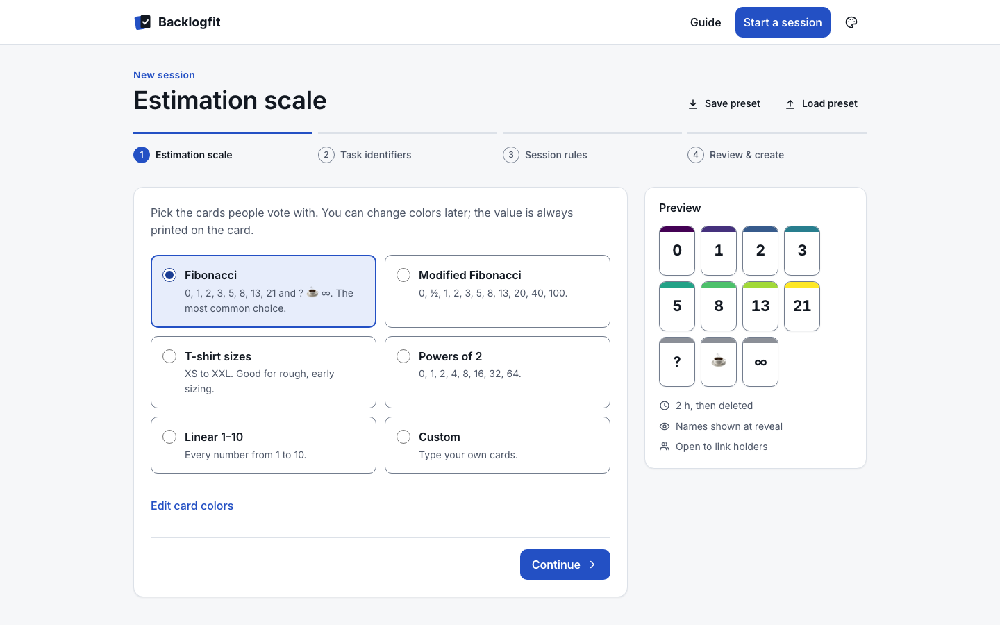
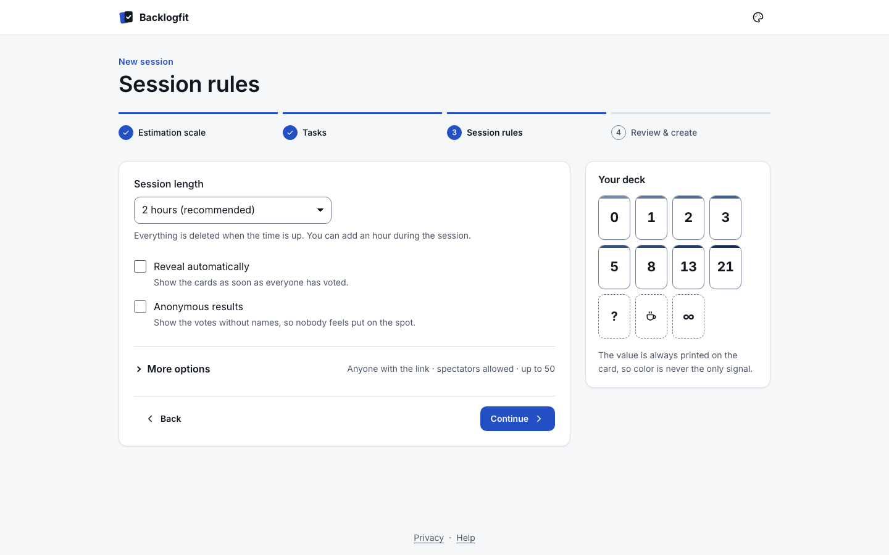
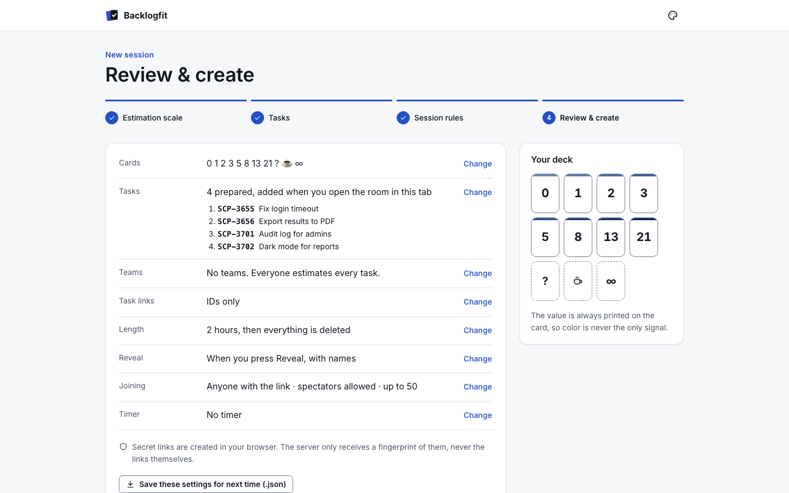
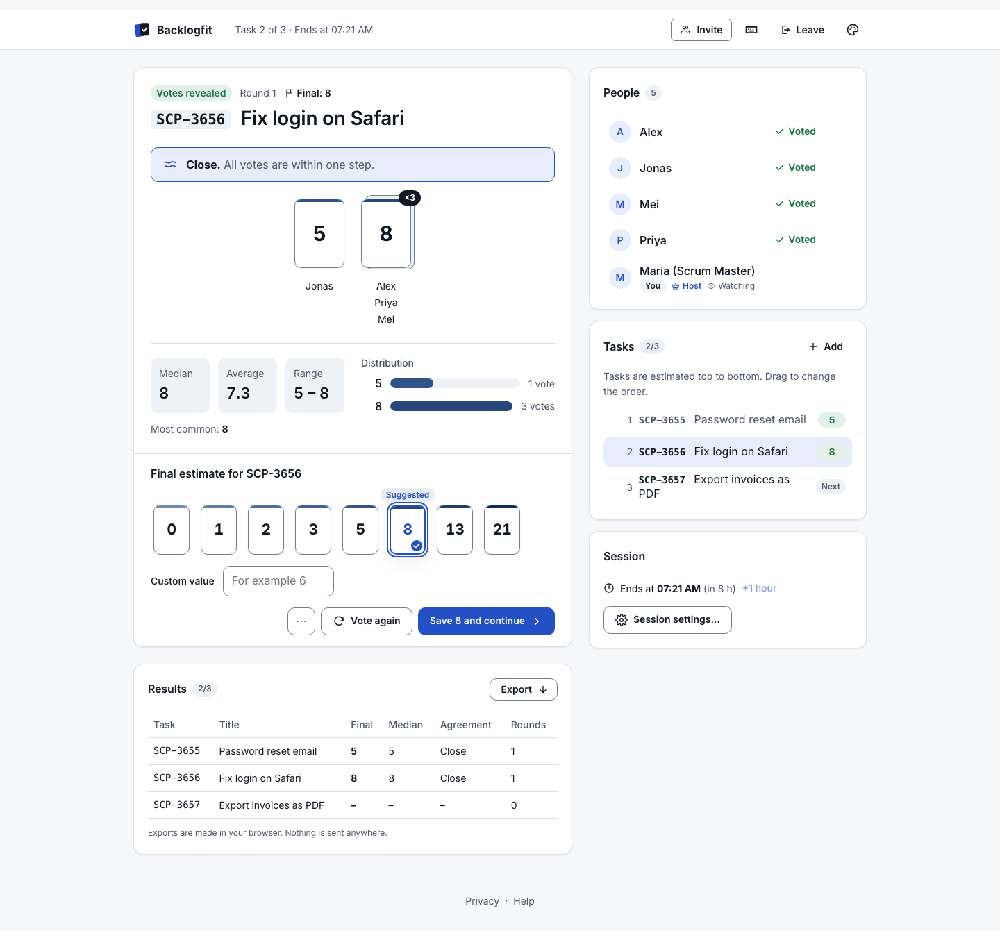
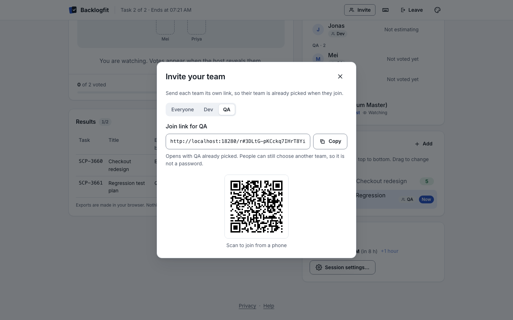
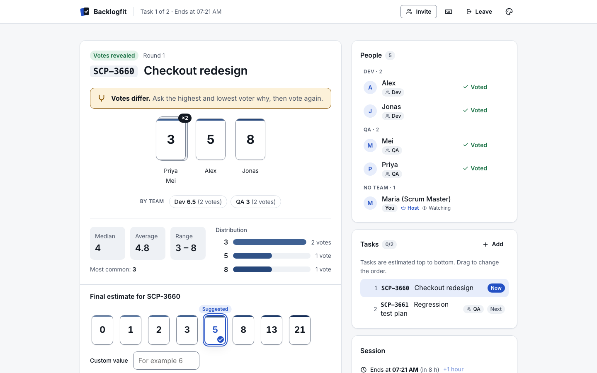
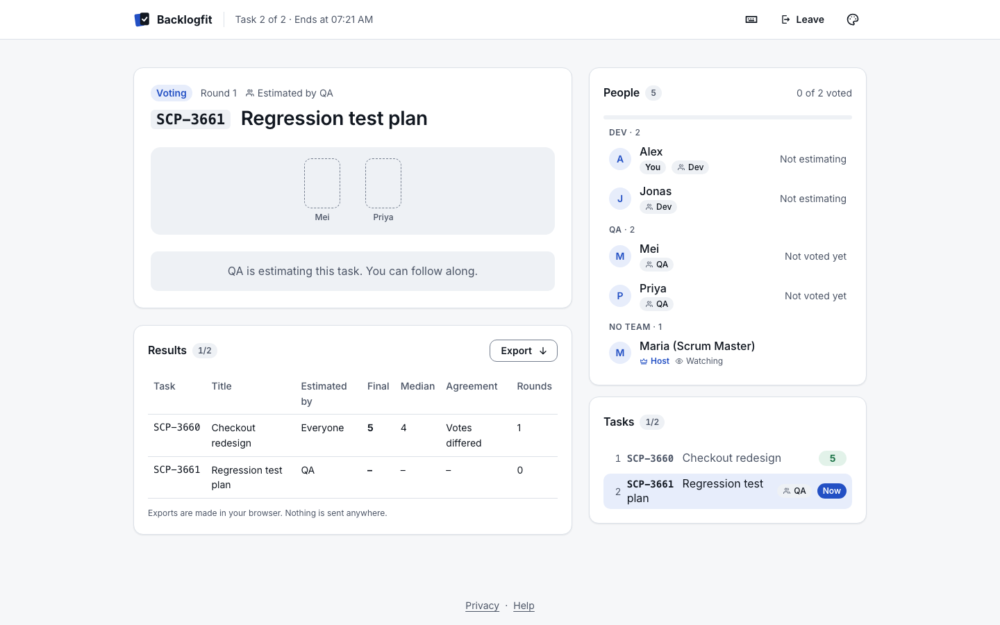

# Backlogfit Manager Guide

*One page for hosts: Scrum Masters, team leads, product owners. Print-friendly.*

## What are story points?

A story point is a team's relative measure of how much effort a backlog item takes,
including complexity, uncertainty and the amount of work. It is not hours. A "2" is roughly
twice a "1"; a "13" is big and probably hides surprises. Because the whole team estimates
together and compares items with each other, story points are quick to give and, over a few
sprints, become a reliable basis for sprint planning.

Why vote with cards? Everyone picks an estimate privately and all cards are revealed at once.
That stops the first loud number from anchoring the others and quickly shows where people
understand an item differently, which is the most valuable outcome of the discussion.

## Run a refinement session in 10 steps

1. **Prepare the list.** Before the meeting, pick 5 to 15 refined backlog items. Copy their IDs
   (with an optional title, for example `SCP-3655 Fix login`) from your tracker, one per line.
2. **Start a session and pick a scale.** Open Backlogfit and choose **Start a session**. Pick a
   deck: Fibonacci is a good default, T-shirt sizes suit rough roadmap sizing.
3. **Paste the tasks and set the session rules.** In the **Tasks** step, paste the list from
   step 1. Every line becomes a task right away; drag them into the order you want to discuss
   them, and fix or remove any line marked in red. Under **Task IDs and links** you can choose how
   tasks may appear (IDs only, any links, or only your own tracker domains). Then set the
   session length, automatic reveal and anonymous results. **More options** holds approval
   before joining, a passcode, spectators, the maximum number of people, the round timer and the
   color style. On the review page, **Change** takes you back to any step; press **Create
   session**. **Save these settings for next time** downloads them as a file, and **Use settings
   from a file…** on the first step loads it again.
4. **Keep the host link.** Backlogfit shows it once. Keep it private: it gives full control of the
   session and lets you switch devices. **Save host link as a file** keeps a copy on your
   computer.
5. **Share the join link.** Paste it in the meeting chat or show the QR code. People enter a
   display name and join as voters or spectators. Then **Open the room** in the same browser tab:
   your prepared tasks are added when the room opens there, and a message confirms it.
6. **Introduce the first item.** Your prepared list is already in the room. Press **Start
   estimating**; the product owner explains the item in two minutes. Tasks are estimated top to
   bottom and items that already have an estimate are skipped. To change course, press ▶ next to
   any task, drag tasks into a new order, or use **Add and estimate now** for an item that comes
   up in the discussion. The **⋯** menu next to **Reveal votes** starts the timer, restarts the
   round or skips the task.
7. **Vote.** Everyone picks a card. You see *who* has voted, never *what*, until the reveal.
8. **Reveal.** Press **Reveal votes** (or let automatic reveal do it when everyone has voted).
   Look at the distribution, median and agreement indicator.
9. **Discuss and vote again if needed.** If the votes differ, ask the highest and lowest voter
   why, then press **Vote again**; earlier rounds stay in the results.
10. **Record the final estimate and move on.** Pick the final value (the suggestion is
    preselected) and press **Save 5 and continue**: it saves the estimate and opens the next
    task. At the end, use **Export** to download the results as CSV, Markdown or JSON, copy the
    summary, or print. When you are done, open **Session settings…** and choose **End session
    for everyone**; all its data is deleted.

| Step 1: scale | Step 2: tasks |
|---|---|
|  |  |

| Step 3: session rules | Step 4: review |
|---|---|
|  |  |

## Teams

Use teams when different groups size different work, for example developers and testers.

- **Set them up** in the Tasks step of the configurator (quick picks Dev, QA, BA, Design, or your
  own names, up to six), or later in **Session settings**.
- **Invite each team with its own link.** The session-ready screen and the **Invite** dialog
  have a tab per team. The link only preselects the team; people can still pick another one.
- **Choose who estimates each task.** End a line with a tag such as `#qa`, use **Estimated by**
  next to the add form, or use the task's menu. Only that team gets the cards and the reveal
  waits only for them; everyone else can follow along.
- **Compare teams.** On a task for everyone, the reveal shows each team's median and number of
  votes ("Dev 5 (4 votes) · QA 3 (2 votes)"). In anonymous sessions it is hidden as soon as a team
  has a single vote. The exports have team columns. The final estimate is still one value.
- **Manage people** from the ⋯ menu in the People list: change someone's team, make them a
  spectator or a voter, make them a co-host, or remove them from the session.

## Tips

- **Anchoring.** Do not say your own estimate before the reveal, and ask the product owner not
  to hint at a "hoped-for" number. Reveal all cards at once.
- **Reference items.** Keep two or three finished items as anchors ("this login change was a
  3") and compare new items with them, not with hours.
- **Coffee card.** If someone plays the coffee card, take a five-minute break. Tired teams
  estimate badly.
- **`?` card.** It means "I don't understand the item yet". Clarify before re-voting; do not
  pressure people to pick a number.
- **Splitting `∞` and very large items.** An `∞` or a vote above 13 (or XL) usually means the
  item is too big or too vague. Split it into smaller stories during the session or send it
  back for refinement instead of forcing a number.
- **Timeboxing.** Aim for about 5 minutes per item. Use the timer; if the second round is still
  split, take the higher estimate or park the item.
- **Re-vote etiquette.** Vote again only after new information has been shared. Do not vote again just
  to reach unanimity; "near" consensus (adjacent values) is usually good enough.
- **Anonymous reveal.** Turn it on for new or hierarchical teams so that nobody feels exposed
  by an outlier vote.
- **Managers in the room.** If you are the team's manager, consider joining as a spectator.
  Estimates are the team's commitment, not a target.

## FAQ for managers

**Can I compare story points between teams?** No. Each team's scale is its own. Use points for
planning within a team, not as a performance metric.

**Can I convert points to hours or days?** Avoid it. Use the team's velocity (points finished
per sprint) to forecast instead.

**Is it safe to use with confidential backlog items?** Rooms need no accounts, store nothing
after they close, and never send votes to anyone before the reveal. For the strictest settings,
use the IDs-only link policy or your company's self-hosted instance.

**Who sees the votes?** Before the reveal: nobody except the voter. After the reveal: everyone
in the room, or only the distribution if anonymous reveal is on.

**What if I lose the host link?** It cannot be recovered (the server only stores a hash).
Create a new room; it takes a minute.

**How long can a session run?** Up to the lifetime you chose (default 2 hours, maximum 8);
add an hour with **+1 hour** in the Session panel. Lock the session and end it from **Session
settings…**. Rooms close after 30 minutes without activity.

More answers: [FAQ](FAQ.md).
