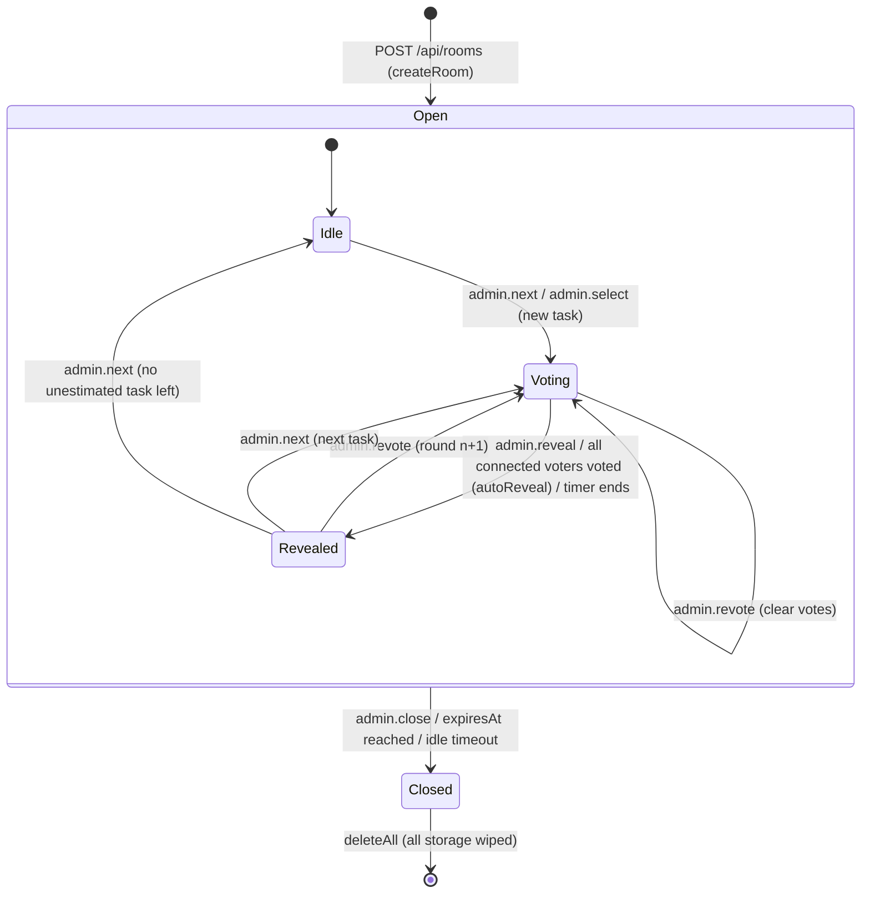

# Backlogfit wire protocol (v1)

Source of truth: `packages/core/src/schemas.ts` (Valibot). This document describes what those
schemas and the reducer (`packages/core/src/reduce.ts`) actually do. If they disagree, the code
wins and this file is a bug.

- Transport: JSON **text** frames over WSS (`/ws/:roomId`). Binary frames are accepted only if
  they are valid UTF-8 JSON (decoded strictly).
- Protocol version: `1`. Only `hello` carries `v`; a hello with any other `v` gets
  `error{code:'unsupported_version'}`.
- All objects are **strict**: unknown keys are rejected (this includes `__proto__`).
- Strings are length-capped; user-visible text is NFC-normalized, trimmed, and rejected if it
  contains C0/C1 controls, zero-width characters or bidi controls.

## 1. Inbound pipeline (every frame)

```
frame ──► size cap (default 16 KiB, MAX_MESSAGE_BYTES) ──► JSON.parse (try/catch)
      ──► version check (hello) ──► ClientMessageSchema.safeParse
      ──► [adapter] rate limit ──► [adapter] toEvent(): verifyHello() for hello
      ──► reduce(state, event, ctx) ──► expandEffects() ──► sockets / storage / alarm
```

`parseClientMessage(raw, maxBytes)` returns `{ ok: true, msg } | { ok: false, code }` and never
throws. Codes: `too_large`, `bad_json`, `unsupported_version`, `invalid_message`. The adapter
answers with `error{code}`; closing after repeated invalid frames (1008) is adapter policy.

## 2. HTTP

| Method | Path | Body | Response |
|---|---|---|---|
| `POST` | `/api/rooms` | `CreateRoomRequest` (below) | `201 { roomId, expiresAt }` |
| `GET` | `/api/health` | none | `200 { ok: true }` (Node only) |
| `GET` | `/ws/:roomId` | WebSocket upgrade, Origin checked | 101 / 403 / 404 |

`CreateRoomRequest` (`parseCreateRoomRequest`):

```ts
{
  v: 1,
  config: RoomConfig,             // see §5
  joinHash: string,               // hex SHA-256 of joinSecret (browser-generated, 128-bit)
  adminHash: string,              // hex SHA-256 of adminSecret
  lifetimeHours: 1..24,           // clamped to MAX_LIFETIME_HOURS by createRoom()
  passcode?: { salt: hex(16..64), hash: hex64 }  // hash = SHA-256(`${salt}:${NFC(trim(passcode))}`)
}
```

`roomId` is generated by the server (128-bit base64url) and passed to `createRoom(req, roomId, ctx, limits)`.

## 3. Client → server

| type | payload | who | notes |
|---|---|---|---|
| `hello` | `v:1, joinSecret, name (1–40), role:'voter'\|'spectator', passcode? (≤64), adminSecret?, resumeToken?` | anyone, first | secrets are base64url 16–128 chars |
| `vote` | `taskId, round (1–1000), value` | voter | current task, current round, voting phase, value on scale |
| `unvote` | `taskId, round` | voter | same checks |
| `ping` | `{}` | any joined | `pong{serverTime}`; does not count as activity |
| `admin.tasks.add` | `lines: string[]` (1–200, each ≤ 2400 chars) | facilitator | each line re-parsed with the room's link policy |
| `admin.tasks.remove` | `taskId` | facilitator | clears current task if removed |
| `admin.tasks.move` | `taskId, toIndex` | facilitator | index clamped |
| `admin.select` | `taskId` | facilitator | starts round 1 if the task has none |
| `admin.next` | `{}` | facilitator | next task without a final, after the current one, wrapping; none left → idle |
| `admin.reveal` | `{}` | facilitator | voting phase only |
| `admin.revote` | `{}` | facilitator | revealed → new round (history kept); unrevealed → clears votes |
| `admin.final` | `taskId, value: string(1–16) \| null` | facilitator | any text (not limited to the scale); `null` clears |
| `admin.timer` | `action:'start'\|'stop', seconds? (5–3600)` | facilitator | default: settings.timerSeconds, else 60 |
| `admin.settings` | partial `autoReveal, anonymousAfterReveal, allowSpectators, lobby, timerSeconds (5–3600 \| null)` | **admin** | turning the lobby off admits everyone waiting |
| `admin.lock` | `locked` | facilitator | unlocking also resets the passcode failure counter |
| `admin.kick` | `participantId` | facilitator | co-admins can kick regular participants only; nobody can kick an admin |
| `admin.promote` / `admin.demote` | `participantId` | **admin** | none ↔ coadmin |
| `admin.lobby` | `participantId, decision:'approve'\|'deny'` | facilitator | |
| `admin.extend` | `hours (1–24)` | **admin** | `expiresAt = min(expiresAt + hours, createdAt + MAX_LIFETIME)` |
| `admin.close` | `{}` | **admin** | closes everyone, deletes storage |

Authority levels: **admin** (presented a valid `adminSecret`), **coadmin** (promoted by an
admin), **none**. "Facilitator" = admin or coadmin. Role (`voter`/`spectator`) is independent of
authority: an admin who joined as a spectator cannot vote.

## 4. Server → client

| type | payload |
|---|---|
| `welcome` | `v:1, you:{ participantId, role, authority, isAdmin, resumeToken? }, room: RoomView, serverTime` |
| `state` | `rev, room: RoomView`: full projected snapshot after every change |
| `lobby` | `status:'waiting'\|'denied', resumeToken?` (token sent with `waiting`) |
| `error` | `code: ErrorCode, ref?` (`ref` = offending message type, or `lines:0,3` for task lines) |
| `closed` | `reason: CloseReason` (always followed by the socket closing) |
| `pong` | `serverTime` |

Clients can validate with `parseServerMessage()`.

### Error codes

| code | meaning |
|---|---|
| `too_large`, `bad_json`, `invalid_message`, `unsupported_version` | frame rejected before the reducer |
| `not_joined` | message before a successful hello |
| `already_joined` | second hello on the same connection |
| `unauthorized` | bad admin secret (or adapter sent a hello without auth) |
| `forbidden` | insufficient role/authority |
| `room_locked`, `room_full`, `spectators_disabled` | join refused |
| `bad_passcode`, `passcode_locked` | passcode wrong / attempt limit reached (room-wide) |
| `lobby_waiting` | waiting participants can't send anything but hello |
| `not_voting`, `wrong_task`, `wrong_round`, `invalid_value` | vote checks |
| `unknown_task`, `unknown_participant`, `invalid_target`, `no_current_task` | admin target checks |
| `too_many_tasks` | would exceed MAX_TASKS (whole message rejected) |
| `invalid_task` | some lines rejected (`ref: lines:<indices>`), valid lines were added |
| `rate_limited` | reserved for adapters |

### Close reasons and codes (`closeCodeFor`)

| reason | code | when |
|---|---|---|
| `expired` | 4001 | hard expiry |
| `idle` | 4002 | no admin/voter activity for IDLE_TIMEOUT |
| `closed` | 4003 | admin closed the room |
| `kicked` | 4004 | removed by a facilitator |
| `denied` | 4005 | lobby request denied |
| `replaced` | 4006 | same participant resumed on another connection |
| `rejected` | 4008 | join refused (locked, full, passcode, bad admin secret) |
| `not_found` | 4404 | unknown room **or wrong join secret** (indistinguishable on purpose) |

## 5. RoomConfig

```ts
{
  scale: Card[2..20],                         // unique values; estimable cards all 'number' or all 'tshirt'
  taskPolicy?: 'ids' | 'links' | 'allowlist', // default 'ids'
  allowlist?: string[≤50],                    // hostnames; normalized to lower-case punycode; subdomains allowed
  idPattern?: string | null,                  // ≤100 chars, safe subset (no lookaround, backrefs, quantified groups)
  linkTemplate?: string | null,               // contains {id} once; http(s); must satisfy the policy
  autoReveal?: boolean,                       // default true
  anonymousAfterReveal?: boolean,             // default false
  allowSpectators?: boolean,                  // default true
  lobby?: boolean,                            // default false
  timerSeconds?: 5..3600 | null,              // default null
  maxParticipants?: 2..500,                   // default 50, clamped to MAX_PARTICIPANTS
  theme?: 'corporate' | 'colorful'            // default 'corporate'
}
Card { value (1–8), label (1–24), numeric? (number cards only), kind: 'number'|'tshirt'|'special', color: '#rrggbb' }
```

### Task lines (`parseTaskLine`)

Accepted shapes: `SCP-3655`, `SCP-3655 Fix login`, `https://…`, `https://… title`, plain title.
Only `http:`/`https:`; no credentials; `javascript:`, `data:`, `vbscript:`, `file:`, `blob:`,
`about:` rejected; titles ≤ 200 and must not contain `://`.

| policy | URLs | IDN (`xn--`) hosts |
|---|---|---|
| `ids` | never stored. If the URL's last path segment matches the ID pattern, the key is kept (URL dropped, re-derived from `linkTemplate` if set); otherwise `links_disabled` | n/a |
| `links` | any http(s) URL | rejected (homograph risk) |
| `allowlist` | host must equal or be a subdomain of an entry | allowed only if allowlisted (comparison on punycode) |

Default ID pattern `[A-Z][A-Z0-9_]{0,15}-[0-9]{1,9}`, case-insensitive, key upper-cased.
With `linkTemplate`, `url = template.replace('{id}', encodeURIComponent(key))`.

## 6. RoomView and the projection rule

`project(state, viewerId)` is the **only** way room data leaves a server. Backends serialize
nothing else.

```ts
RoomView {
  roomId, createdAt, expiresAt, maxExpiresAt, idleAt,
  me: { participantId, role, authority } | null,
  config: { scale, taskPolicy, allowlist /* facilitators only, else [] */, idPattern, linkTemplate, maxParticipants, theme },
  settings: { autoReveal, anonymousAfterReveal, allowSpectators, lobby, timerSeconds, locked,
              passcodeRequired, passcodeLocked /* facilitators only, else false */ },
  participants: { id, name, role, authority, connected, hasVoted }[],   // active only
  lobby: { id, name, role }[],                                          // facilitators only, else []
  tasks: { id, key, title, url, final, rounds: RoundView[] }[],
  currentTaskId, phase: 'idle'|'voting'|'revealed', round: number|null,
  myVote: string | null,            // viewer's own vote in the current round
  timer: { endsAt, seconds } | null,
}
RoundView { n, revealed, anonymous, voteCount, votes: VoteView[] | null, stats: Stats | null }
VoteView  { participantId: string|null, name: string|null, value }
```

Rules (asserted by fast-check properties over arbitrary event sequences):

1. **Before reveal** a round has `votes: null, stats: null`. The only vote value anywhere in the
   view is `myVote`. Non-interference: changing any other participant's unrevealed vote leaves
   the viewer's projection byte-for-byte identical.
2. **After reveal** values are included. If the round is anonymous, `participantId` and `name`
   are `null` and values are **sorted by scale order** (not shuffled: a shuffle seeded from room
   state can be inverted, a sort carries no linkage at all).
3. A round's `anonymous` flag is fixed when it starts and can only be switched **on** later;
   turning the setting off never de-anonymizes votes already cast.
4. Never present: join/admin/passcode hashes, salts, resume hashes, connection ids, failure
   counters, other participants' tokens.

### Stats (`computeStats`)

`{ total, estimableCount, basis: 'numeric'|'ordinal', distribution, special, min, max, median,
average, mode[], spreadSteps, consensus, suggested }`. Special cards are excluded from numeric
stats and counted in `special`. T-shirt (ordinal) scales use 0-based step positions for
`median`/`average`. Consensus: `full` (spread 0), `near` (spread ≤ 1 step), `split` otherwise.
`suggested` = card nearest the median (ties → larger card).

## 7. Lifecycle



Join flow:

```
hello ─► joinOk? ──no──► closed{not_found}
          │yes
          ├─ adminSecret given but wrong ─► error{unauthorized} + closed{rejected}
          ├─ resume token matches ─► same participant (id, role, authority, vote);
          │                          old socket gets closed{replaced}; new token issued
          ├─ admin ─► welcome (bypasses lock, passcode, lobby, capacity)
          └─ locked? spectators allowed? passcode ok (room-wide attempt limit)? capacity?
               └─ lobby on ─► lobby{waiting, resumeToken} … admin.lobby ─► welcome | closed{denied}
               └─ lobby off ─► welcome{resumeToken}
```

## 8. Adapter contract

```ts
const parsed = parseClientMessage(frame, MAX_MESSAGE_BYTES);
if (!parsed.ok) return sendError(parsed.code);
const event = await toEvent(state, connId, parsed.msg);      // runs verifyHello() for hello
const { state: next, effects } = reduce(state, event, { now: Date.now(), randomId });
for (const out of expandEffects(next, effects)) …            // send | close | scheduleAlarm | deleteAll
```

- Events: `connect{conn}`, `disconnect{conn}`, `tick` (alarm fired), `message{conn, msg, auth?}`.
  `ctx = { now, randomId }`: the only source of time and ids. `randomId` must be a CSPRNG id.
- `reduce` returns the **same object** when nothing changed; persist only when `next !== state`.
- `broadcastState` → one `state` per active connection, each projected for its viewer
  (`expandEffects` does this). Lobby and pre-hello sockets get nothing.
- `close` → `expandEffects` emits `closed{reason}` then a close with `code`.
- `scheduleAlarm{at}` → single room alarm (`at: null` = cancel). Alarms may fire early; a `tick`
  simply reschedules. The reducer does not move the alarm later on every action.
- `deleteAll{reason}` → wipe storage, close **every** remaining socket (including pre-hello ones)
  with `closed{reason}`, and do not persist the returned state.
- `verifyHello` awaits WebCrypto; on Workers other events can interleave, so always reduce
  against the **current** state after the await (the reducer re-validates the resumed id).
- A resumed participant may exceed `maxParticipants` by reconnecting into a full room; resume
  also bypasses lock and passcode (they were admitted before).

## 9. Examples

```json
→ {"type":"hello","v":1,"joinSecret":"3q2-7wX0Vb1nM4kP9sL2aQ","name":"Ada","role":"voter"}
← {"type":"welcome","v":1,"you":{"participantId":"p_9f","role":"voter","authority":"none","isAdmin":false,"resumeToken":"…"},"room":{…},"serverTime":1767225600000}
→ {"type":"vote","taskId":"t_1","round":1,"value":"5"}
← {"type":"state","rev":12,"room":{…,"phase":"voting","myVote":"5","tasks":[{"id":"t_1","rounds":[{"n":1,"revealed":false,"anonymous":false,"voteCount":3,"votes":null,"stats":null}],…}]}}
→ {"type":"admin.reveal"}
← {"type":"error","code":"forbidden","ref":"admin.reveal"}
← {"type":"closed","reason":"expired"}
```
