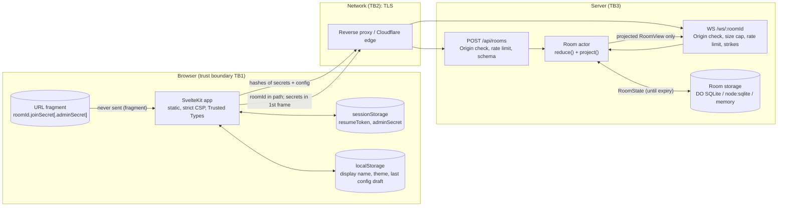

# Backlogfit threat model

Status: v0.2 (2026-10-20, Phase C final review). Method: data-flow diagram + STRIDE per component. Owner: security
maintainer (A4). Review this document whenever the protocol (docs/protocol/PROTOCOL.md), a
backend adapter, or the deployment model changes.

Findings that are still open are tracked in `coordination/A4.md` (SEC-xxx) and summarized in
[SECURITY_REVIEW.md](SECURITY_REVIEW.md).

## 1. System description

Backlogfit is a real-time story point estimation tool. A facilitator opens `/new`, configures a
deck and task policy, and the browser creates a room. Participants join through a link, vote on
cards, the facilitator reveals, and the team agrees a final estimate. Rooms are ephemeral: they
expire after 1-8 h (default 2 h, hard maximum `MAX_LIFETIME_HOURS`, default 8 h) or after
30 min without activity, and all room data is then deleted.

There are no accounts. Possession of a link is the credential:

| Secret | Created by | Size | Lives in | Server keeps |
|---|---|---|---|---|
| `roomId` | server (CSPRNG) | 128 bit | link fragment, WS path | plain (routing key, not a secret) |
| `joinSecret` | browser (WebCrypto) | 128 bit | join link fragment | SHA-256 only |
| `adminSecret` | browser | 128 bit | admin link fragment, `sessionStorage` | SHA-256 only |
| `resumeToken` | server, per participant, rotated on every join | 128 bit | `sessionStorage` | SHA-256 only |
| `passcode` (optional) | facilitator | human | told out-of-band | salted SHA-256, attempts capped room-wide |

Deployments:

- **Cloudflare**: static assets + a Worker (Hono) routing to one Durable Object per room (SQLite
  storage, WebSocket Hibernation, alarms). Observability, logs, Logpush and preview URLs are
  disabled in `apps/worker/wrangler.jsonc`.
- **Self-hosted**: one Node 24 process (`apps/server`) serving the static build, `POST
  /api/rooms` and `/ws/:roomId`, room state in `node:sqlite` (`DATA_DIR`) or memory, packaged
  as a distroless non-root container (`apps/server/Containerfile`) behind the operator's
  TLS reverse proxy.

All room behaviour is one pure reducer in `packages/core` (ADR-0001); the backends only move
bytes, rows and timers. Only per-viewer projections (`project()`) ever leave the server.

## 2. Data flow

Trust boundaries: **TB1** the participant's browser and device (and anything installed in
it); **TB2** the network path including the TLS terminator (Cloudflare edge or the operator's
proxy); **TB3** the server process and its storage; **TB4** the build and release pipeline
(GitHub Actions, npm registry, container base images), which produces everything in TB1 and
TB3.

## 3. Assets

| Asset | Why it matters |
|---|---|
| A1 Unrevealed votes | The core promise: nobody (including the facilitator) sees a vote before reveal. Anchoring bias is the product's reason to exist. |
| A2 Task text and links | May contain confidential project names, ticket titles, internal URLs. |
| A3 Display names and the fact of participation | Personal data (who attended which session). |
| A4 Room secrets (join/admin/resume/passcode) | Grant access and facilitator control. |
| A5 Availability of rooms and of the server | A meeting depends on it. |
| A6 Client IP / user agent | Personal data; must not be stored or logged by the app. |
| A7 Integrity of the shipped code (web bundle, server image) | Whoever controls it controls every other asset. |

## 4. STRIDE per component

Legend: **M** = mitigation in place (file reference), **R** = residual risk (section 5).

### 4.1 Browser app (`apps/web`)

| Threat | Example | Mitigation |
|---|---|---|
| S Spoofing | Participant picks a name identical to the facilitator's | Names are NFC-normalized, trimmed, length-capped, control/bidi/zero-width characters rejected (`packages/core/src/schemas.ts` `text()`, `src/text.ts`). Authority badges come from server state, not names. Invisible fillers, surrogates and tag characters rejected, names need a visible character (SEC-002, fixed). |
| T Tampering | XSS via task title, name or link | No `{@html}`, no `innerHTML`; Svelte text interpolation only. CSP `script-src 'self'`, `script-src-attr 'none'`, `style-src 'self'`, `object-src 'none'`, `base-uri 'none'` plus Trusted Types (`packages/security/src/headers.ts`). Build fails on any inline script/style/handler/`javascript:` URL (`apps/web/scripts/externalize.ts`). Task links: http(s) only, no credentials, no IDN hosts under the open policy (`packages/core/src/tasks.ts`); the UI must render them as text with `rel="noopener noreferrer"` (review item for the room UI). |
| R Repudiation | "I never voted 13" | Out of scope: no audit trail by design (privacy). Revealed votes are visible to all participants at the time. |
| I Information disclosure | Secrets leak through Referer, history sync, analytics | Secrets only in the fragment (never sent in HTTP), `Referrer-Policy: no-referrer` + `<meta name="referrer">`, no third-party requests (ADR-0009, CSP `default-src 'none'`), `/r` and `/new` are `no-store` + `noindex`. R: link sharing (4.2), browser extensions, screen sharing. |
| D Denial of service | Malicious frame crashes the client | Server frames validated with `parseServerMessage` before use; view is a full snapshot (ADR-0003). |
| E Elevation | Voter tries admin actions from devtools | Every authorization decision is server-side in the reducer (`packages/core/src/reduce.ts` `admin()`), UI hiding is cosmetic only. |

### 4.2 Link sharing (fragment secrets)

| Threat | Example | Mitigation |
|---|---|---|
| S | Someone who obtained a join link joins as a fake team member | Optional lobby (facilitator approves each joiner), optional passcode told verbally, room lock, kick. Participant list is visible to everyone. |
| T | Link altered to point to a lookalike host | Links are generated by the app with the deployment's own origin; QR code shows the same URL. Users should check the host (residual). |
| I | Admin link pasted into a chat channel instead of the join link | The admin link is shown once with a warning (PLAN §1.1) and is not needed to participate. R: anyone with the admin link is an admin until the room ends. |
| I | Link visible in a screenshot, screen share, projector or chat history | Not preventable technically. Rooms are short-lived; lock the room once everyone is in; use the lobby or a passcode in large or external meetings. |
| E | Join link used after the meeting | Room expires (≤ 8 h) or idles out (30 min); the facilitator can close it at once (`admin.close`). |

### 4.3 HTTP API (`POST /api/rooms`, `GET /api/health`)

| Threat | Example | Mitigation |
|---|---|---|
| S | Cross-site page creates rooms in the victim's name | No ambient authority (no cookies); Origin checked against `PUBLIC_ORIGIN`/`ALLOWED_ORIGINS` (`isAllowedOrigin`, exact canonical match); `Content-Type: application/json` required (forces CORS preflight). |
| T | Malformed or hostile config (prototype keys, huge arrays, ReDoS patterns) | Strict Valibot schema, unknown keys rejected, string/array caps, body limit 64 KiB (`apps/server/src/app.ts`); fuzzed in `packages/security/test/fuzz/tasks.test.ts`. Admin ID patterns run on a regex-free matcher with hard budgets (`packages/core/src/idpattern.ts`, SEC-001 fixed). |
| R | — | No logs by design. |
| I | Response reveals server internals | Errors are fixed codes (`{error:"bad_json"}`), no stack traces, no `X-Powered-By`/`Server` (`applySecurityHeaders`). |
| D | Room-creation flood exhausts `MAX_ROOMS` | Per-client token bucket (`ROOM_CREATE_PER_MIN`), `MAX_ROOMS` cap, Cloudflare rate-limit binding on Workers. Key = `clientIp()` keyed hash, proxy hops counted from the right (SEC-003 fixed). |
| E | — | The API can only create rooms; it never reads or modifies one. |

### 4.4 WebSocket (`/ws/:roomId`)

| Threat | Example | Mitigation |
|---|---|---|
| S | Guessing a join secret / passcode | 128-bit secrets; constant-time digest compare (`ctEqual`); wrong join secret answers exactly like an unknown room (`closed{not_found}`, decoy room on Node); passcode attempts capped room-wide (`PASSCODE_MAX_ATTEMPTS`) then refused until a facilitator unlocks. |
| S | Cross-site WebSocket hijacking | Origin allowlist checked on upgrade (403); secrets are in the first frame, not in cookies. |
| T | Oversized, deeply nested or malformed frames; prototype pollution | Size cap before parse (`MAX_MESSAGE_BYTES`, `ws` `maxPayload`, `frameTooLarge`), strict UTF-8, `JSON.parse` in try/catch, strict schema (unknown keys incl. `__proto__`/`constructor` rejected), fuzzed with arbitrary strings/bytes/JSON, 100 000-level nesting, hostile numbers and Unicode (`test/fuzz/client-message.test.ts`). |
| R | — | No logs by design. |
| I | Vote values before reveal; other participants' resume tokens; allowlist or lobby to non-facilitators | Projection rule: `project(state, viewer)` only (`packages/core/src/project.ts`), backends send only `expandEffects` output. Property tests (core) and end-to-end fuzz with hostile actors and real hashing (`test/fuzz/room.test.ts`) assert: no unrevealed values, no secrets/hashes/foreign tokens in any frame, unauthenticated sockets receive only `error`/`closed`. |
| I | Existence of a room from a roomId alone | Unknown rooms get a decoy with the same pipeline (`apps/server/src/rooms.ts` `decoy`). Room capacity is enforced on hello, pre-hello sockets are bounded per client (Node) or evicted oldest-first (Worker) (SEC-005 fixed). |
| D | Message floods, socket floods, silent sockets | Per-connection and per-room token buckets, strike counter → 1008, hello timeout → 1008, heartbeat. Global and per-client connection caps plus an upgrade bucket (Node), upgrade rate-limit binding (Worker) (SEC-004 fixed). |
| E | Voter sends admin commands; co-admin closes the room; spoofed `isAdmin` key | Reducer checks authority per message (`isFacilitator`, admin-only set); unknown keys rejected by schema; fuzzed with forgers holding a wrong admin secret. |

### 4.5 Room actor and storage (Durable Object / Node room / SQLite)

| Threat | Example | Mitigation |
|---|---|---|
| T | Interleaving between async hello verification and reduce | Hello verified before reduce, reducer re-validates against current state (ADR-0005); Node serializes per room through a promise queue. |
| I | Room data outlives the room | On expiry/idle/close the reducer emits `deleteAll`: Workers `ctx.storage.deleteAll()` + alarm cleared; Node deletes the row with `PRAGMA secure_delete=ON` and `wal_checkpoint(TRUNCATE)` (`apps/server/src/store.ts`). Overdue rooms are expired on restart. Worker writes storage only for real rooms (SEC-010 fixed). |
| I | Disk holds room content while the room lives | The Node image defaults to memory only (SEC-007 fixed); with `DATA_DIR` the volume holds RoomState JSON (names, tasks, unrevealed votes, secret hashes) until expiry. Encrypt the volume or keep memory-only. |
| I | Secrets in state | Only SHA-256 hashes stored; raw secrets never enter `RoomState` (ADR-0005). |
| D | One room starves others (CPU) | Per-room bucket, ≤ 50 participants, ≤ 500 tasks, ≤ 200 lines per add. ID-pattern matching is O(atoms × 64²) (SEC-001 fixed). |
| E | Adapter forges `HelloAuth` | Adapters are trusted code; reviewed (ADR-0005). |

### 4.6 Container and host (self-hosting)

| Threat | Example | Mitigation |
|---|---|---|
| T | Attacker modifies the app on disk after an RCE | Distroless image (no shell, no package manager), non-root UID 65532, `read_only: true`, `cap_drop: [ALL]`, `no-new-privileges`, tmpfs `/tmp` (`apps/server/compose.example.yml`, [SELF_HOSTING.md](SELF_HOSTING.md)). |
| I | Reverse proxy access logs keep IPs, user agents and roomIds | App logs nothing per request; the operator must disable or anonymize proxy logs (snippets in SELF_HOSTING.md). The WS path contains only the roomId; secrets never appear in request lines. |
| D | Resource exhaustion of the host | `mem_limit`, `pids_limit`, CPU limit recommended; env limits (`MAX_ROOMS`, `MAX_PARTICIPANTS`, …). |
| E | Container escape / lateral movement | No capabilities, no privilege escalation, no outbound network needed (egress deny recommended), binds to 127.0.0.1 behind the proxy. |

### 4.7 CI / supply chain

| Threat | Example | Mitigation |
|---|---|---|
| T | Compromised npm package or GitHub Action | Lockfile with integrity hashes, `--frozen-lockfile`, few dependencies (each justified in `docs/dependencies/`), pnpm `allowBuilds` limited to `esbuild`/`workerd`, actions pinned by commit SHA, `permissions: {}` by default, harden-runner, Dependabot, OSV-Scanner, `pnpm audit`, CodeQL, Scorecard. Proposed: `minimumReleaseAge`, `trustPolicy: no-downgrade`, Dependabot cooldown (coordination/A4.md). |
| T | Tampered release image | Trivy scan before push, BuildKit provenance + SBOM, GitHub build-provenance and SBOM attestations, cosign keyless signature; users verify with `cosign verify` / `gh attestation verify`. |
| I | Secret committed to the repo | gitleaks over full history in CI. No secrets are needed at runtime. |
| E | Workflow injection via PR titles/branches | No untrusted `${{ }}` interpolation into `run:`; CodeQL `actions` analysis. |

## 5. Residual risks (accepted, documented for reviewers)

1. **Link leakage.** Whoever has the join link can join (unless lobby/passcode/lock is used);
   whoever has the admin link is an admin. Links end up in chat history, screenshots, screen
   shares, projectors, QR photos, clipboard managers and browser history sync (the fragment is
   part of the URL a browser stores locally). Mitigation is procedural: lock the room, use the
   lobby or passcode, close the room when done, never share the admin link.
2. **A malicious participant** sees everything any participant sees: names, task text and
   links, revealed votes, and can take screenshots. They can join under a misleading name
   (the lobby lets a facilitator check), spam votes within rate limits, or leave and rejoin.
   Anonymous reveal hides who voted what, but with very few voters values can still be
   attributed by elimination.
3. **Shoulder-surfing / screen sharing** of a participant's own card before reveal, or of the
   admin link and QR code.
4. **Infrastructure operator visibility.** TLS terminates at Cloudflare's edge or at the
   self-hoster's proxy. That operator can technically see all traffic, including secrets in
   the first WebSocket frame and room content, and can see client IP addresses at connection
   time. Backlogfit disables its own logging and storage of IPs, but cannot control
   Cloudflare's infrastructure or a self-hoster's proxy. Self-hosting removes third parties.
   End-to-end encryption of task text is designed (ADR-0008) but not active in v1.
5. **Browser extensions and endpoint compromise** can read the page, the fragment and
   `sessionStorage`. Out of the app's control; managed browsers in enterprises should restrict
   extensions.
6. **Passcode strength.** Salted single SHA-256: an attacker with the room row can brute-force a
   short passcode offline (SEC-008, accepted: the server sees the passcode in `hello` anyway).
7. **Persistence window.** With `DATA_DIR` set, room content is on disk until expiry
   (≤ `MAX_LIFETIME_HOURS`). SQLite `secure_delete` overwrites deleted pages, but filesystem
   snapshots, copy-on-write filesystems or SSD wear-levelling may retain old blocks. Keep
   memory-only or use an encrypted volume.
8. **Per-instance rate limits.** Counters reset on restart and are per process/isolate.
9. **Hashing of client IPs in memory** defends logs and heap dumps, not an attacker who can read
   process memory (the key is there too).
10. **Room existence and timing.** A party who knows a roomId but not the join secret gets the
    same answers from real and unknown rooms (SEC-005 fixed); sub-millisecond timing differences
    may remain and are dwarfed by network jitter.
11. **Admin link in the address bar** (SEC-014, open, Low): visible in browser history and screen
    shares of the facilitator's window until fixed.

## 6. Out of scope

- Accounts, SSO and audit trails (Phase 2 OIDC is designed in ADR-0010, not active).
- Protection against a compromised Cloudflare account, host OS, hypervisor or CI provider.
- Physical security, social engineering, phishing for links.
- Legal hold / records retention (the product deliberately keeps nothing).
- Denial of service at the network layer (volumetric DDoS is the edge/proxy's job).
- Third-party issue trackers that task links point to.

## 7. Verification

- `pnpm --filter @backlogfit/security test`: header, limiter, origin, limits, client-IP,
  frame tests, fast-check properties, and the fuzz suite (`test/fuzz/*`): parser fuzzing,
  task-link bypass corpus, room-creation fuzzing, and random sessions with hostile actors
  through the real hashing pipeline.
- `pnpm --filter @backlogfit/core test`: projection non-interference, authorization,
  lifetime, determinism, CSV injection properties.
- `tests/e2e` (A5): "no vote values on the wire before reveal" by inspecting WebSocket frames.
